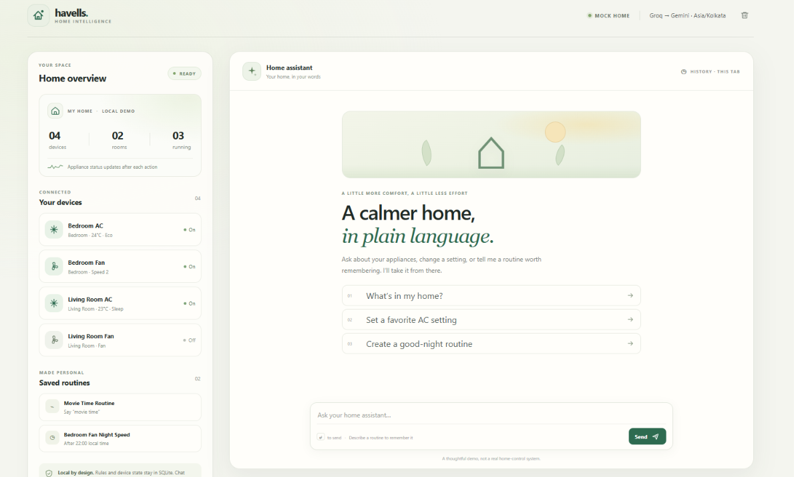
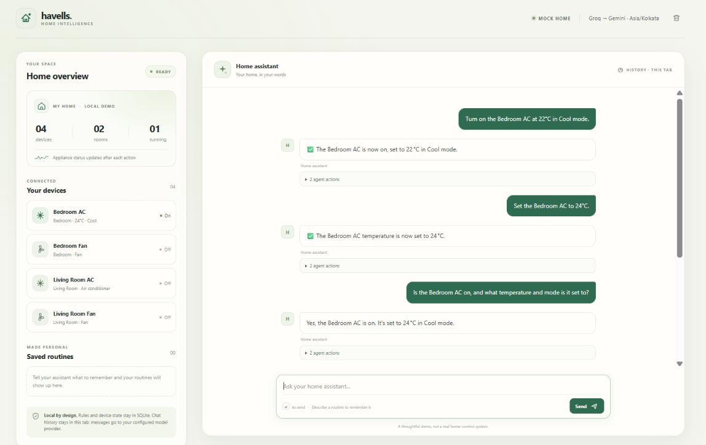
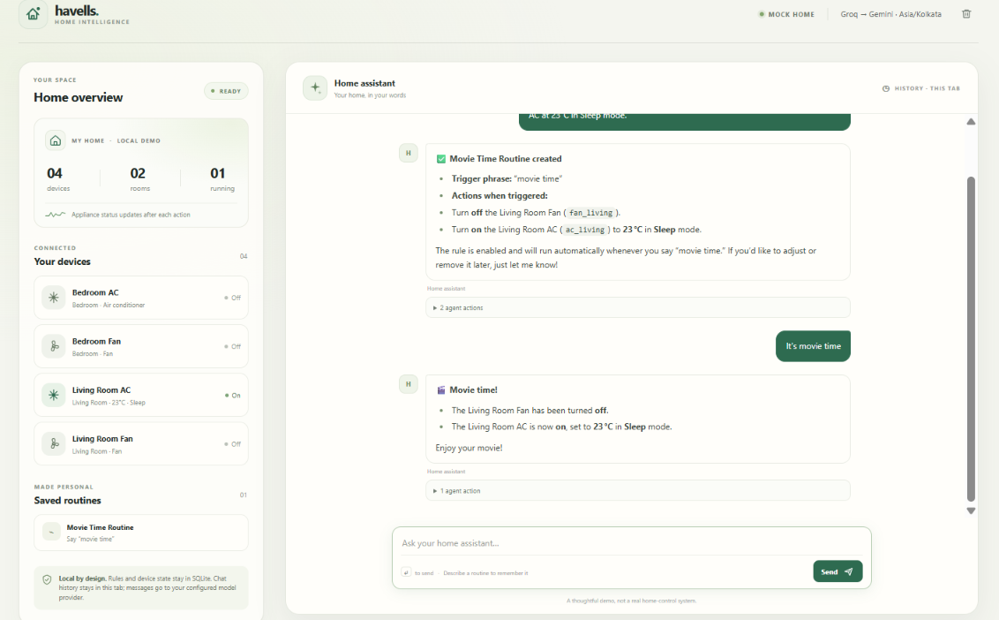

# Havells Smart Home Agent

A small, runnable smart-home assistant for air conditioners and fans. It uses an
OpenAI-compatible LLM API with real function calling, a mock device fleet, and
conversational personalization rules that survive restarts.

## Screenshots

### Smart Home Dashboard



### Conversational Device Control



### Personalization Rules



## What it does

- Answers questions about four mock devices, their capabilities, and live state.
- Lets the model choose device tools; the application validates and executes every
  requested state change.
- Learns default settings, spoken trigger phrases, and after-time preferences from
  natural language. After-time preferences currently apply to fan speed when a
  fan is switched on.
- Applies defaults when a device is switched on, while an explicit value in the
  current request always wins.
- Lets the user inspect, update, disable, enable, and delete saved rules in chat.
- Persists both device state and rules in a local SQLite database.

No speech recognition, text-to-speech, real hardware, or cloud device integration is
included. Devices are intentionally simulated.

## Run locally with Groq and Gemini failover

Requirements: Python 3.11 or newer and at least one valid API key. Groq is the
primary OpenAI-compatible provider; Gemini is configured as the secondary
provider for automatic failover. Both APIs support the function-calling flow
used by the agent.

1. Create and activate a virtual environment, then install the project:

   ```powershell
   py -3.11 -m venv .venv
   .\.venv\Scripts\Activate.ps1
   python -m pip install -e .
   ```

2. Get API keys from [Groq Console](https://console.groq.com/keys) and
   [Google AI Studio](https://aistudio.google.com/apikey).

3. Copy `.env.example` to `.env`. Set `GROQ_API_KEY` to use Groq as the primary
   provider, and set `GEMINI_API_KEY` to enable Gemini failover. At least one
   provider key is required. Groq uses `openai/gpt-oss-20b` by default; Gemini
   uses `gemini-3.8-flash`. Keep `.env` private; it is excluded from Git. Never
   paste API keys into chat or commit them.

4. Start the chat UI:

   ```powershell
   python -m uvicorn smart_home_agent.main:app --app-dir src --reload
   ```

5. Open [http://127.0.0.1:8000](http://127.0.0.1:8000).

If `GROQ_API_KEY` is blank but Gemini is configured, the app skips Groq and uses
Gemini directly until you add the Groq key. With both keys configured, each
request tries Groq first and switches to Gemini on provider failure. Transient
timeouts, connection errors, rate limits, and server errors are retried once
with bounded backoff; a long quota reset bypasses retries and fails over
immediately. The provider that returns the first successful response is pinned
for the rest of that chat turn so another model cannot repeat an already-run
device tool. If every configured provider fails, the chat displays a concise
user-friendly message and refreshes the device overview without exposing
provider diagnostics or claiming success. Chat messages may be sent to multiple
configured providers when retries or failover occur; device state and saved
routines remain in local SQLite.

Retry behavior can be tuned with `LLM_MAX_RETRIES` (0–5),
`LLM_TIMEOUT_SECONDS` (1–300), and `LLM_RETRY_BACKOFF_SECONDS` (0–30).
To use a different OpenAI-compatible service as the primary provider, set
`LLM_PRIMARY_PROVIDER=custom` with `LLM_BASE_URL`, `LLM_API_KEY`, and
`LLM_MODEL`; optionally set `LLM_FALLBACK_PROVIDER` to `groq` or `gemini`.

## Demo script

Try these one at a time:

1. `Which devices do I have?`
2. `Is the bedroom AC on, and what temperature is it set to?`
3. `Whenever I turn on the bedroom AC, set it to 24°C in Eco mode.`
4. `Turn on the bedroom AC.`
5. `Turn on the bedroom AC at 22°C.` The current request overrides the saved
   default temperature.
6. `When I say good night, switch off the living room fan and set the bedroom AC
   to Sleep at 26°C.`
7. `Good night.` The model recognizes the trigger intent and asks the agent to
   execute the matching saved rule.
8. `Remember: after 10 pm, whenever I turn on the living room fan, keep it at
   speed 2.`
9. `What rules do I have?` Then try `Disable the night fan rule.` or
   `Delete the good night rule.`

## Assumptions and known limitations

- Devices are simulated ACs and fans stored in a local SQLite database; no real
  hardware or cloud-device API is connected.
- Speech-to-text and text-to-speech are outside the assignment scope. The web
  chat accepts text directly.
- The demo is single-user and has no login. Do not expose it to an untrusted
  network or use it to control real appliances.
- Fan time rules use the configured local timezone and apply from their start
  time until local midnight. Cross-midnight windows are not supported.
- Phrase routines require the configured phrase to occur in the message and
  the model to identify the message as a command to run it.
- Chat requires a working configured LLM provider, network access, and available
  provider quota. Retries and secondary-provider failover are bounded; they
  cannot overcome exhausted quotas at every configured provider.
- The chat transcript is kept in the current browser tab. Device state and
  rules persist in the local SQLite database.
- Production concerns such as multi-user isolation, authentication, real-device
  confirmation/authorization, rate limits, and operational monitoring are not
  implemented; see [design.md](design.md#production-path).

The `data/smart_home.sqlite3` database is created on first start. Set
`SMART_HOME_DB_PATH` to move it. Stop the server before deleting that file to
reset the demo.

## Tests

```powershell
python -m pip install -e ".[dev]"
python -m pytest
```

Tests use temporary SQLite databases and a fake LLM response; they do not need an
API key, network access, or real appliances.

## Project map

- `src/smart_home_agent/main.py` — HTTP API and app wiring.
- `src/smart_home_agent/agent.py` — model/tool-call loop and system instructions.
- `src/smart_home_agent/llm.py` — OpenAI-compatible API client.
- `src/smart_home_agent/tools.py` — tool schemas, validation, and rule application.
- `src/smart_home_agent/storage.py` — SQLite schema, seeds, and repositories.
- `src/smart_home_agent/static/` — responsive chat interface.
- `design.md` — architecture, rule model, trade-offs, edge cases, and production path.
