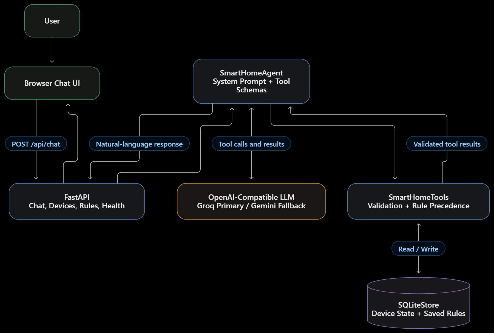

# Design notes: Havells Smart Home Agent

## Scope and assumptions

This is the assignment's mock agent, not a physical-device integration. It ships
four simulated appliances in two rooms: two ACs and two fans. Their capabilities
are deliberately explicit and their state changes are real within the local
SQLite database. Speech recognition, text-to-speech, cloud device APIs, and
multi-user accounts are out of scope.

The user enters already-transcribed text in a small web chat. A user can also use
the JSON API or replace the UI with a CLI without changing the agent or device
layer. The agent uses Groq as its primary hosted provider and Google Gemini as
the configured fallback. Both providers use an OpenAI-compatible
chat-completions endpoint that supports function/tool calls.

## Architecture

The diagram below shows the main request, tool-execution, and persistence paths:



```text
Browser chat
    │  POST /api/chat (current text + short conversation history)
    ▼
FastAPI ── GET /api/devices, /api/rules, /api/health
    │
    ▼
SmartHomeAgent ── system prompt + tool schemas ──► OpenAI-compatible LLM
    │                                                    │
    │◄──── assistant tool call(s) ◄─────────────────────┘
    │
    ├── SmartHomeTools: validate, apply rule precedence, execute
    │       └── SQLiteStore: mock device state + persisted rules
    └── tool results returned to the model before it produces its reply
```

`SmartHomeAgent` owns the bounded model/tool loop; `SmartHomeTools` owns the
function contracts and domain validation; `SQLiteStore` owns persistence. The
provider adapter is a small OpenAI-compatible HTTP client, rather than a provider
SDK, so the model host can be changed using environment variables without
coupling rule or device code to a vendor.

The model, rather than a keyword router, chooses whether to inspect devices,
control one, create or manage a rule, or invoke a spoken trigger. Tool arguments
are validated server-side against the device registry before any state mutation.
Results are sent back to the model so its answer can reflect what actually
happened. Calls in a single assistant turn execute in order, and the loop is
capped at six rounds.

## Rule data model

Each SQLite `rules` row stores a UUID `rule_id`, display `name`, `kind`
(`default`, `phrase`, or `time`), optional `trigger_phrase` or `after_time`,
JSON-encoded partial `actions`, an `enabled` flag, and UTC creation/update
timestamps. The condition is represented by the rule kind and its corresponding
trigger field; actions are an ordered list of device IDs and validated state
fields. Irrelevant trigger columns are stored as `NULL`.

For example, a phrase rule spanning two rooms is represented as:

```json
{
  "rule_id": "generated-uuid",
  "name": "Good night",
  "kind": "phrase",
  "trigger_phrase": "good night",
  "after_time": null,
  "actions": [
    {"device_id": "fan_living", "state": {"power": false}},
    {
      "device_id": "ac_bedroom",
      "state": {"power": true, "temperature": 26, "mode": "Sleep"}
    }
  ],
  "enabled": true,
  "created_at": "UTC timestamp",
  "updated_at": "UTC timestamp"
}
```

Actions intentionally store only the requested fields: defaults fill omitted
settings when power is turned on, and a current explicit command takes
precedence. Tool validation checks device capabilities before a rule is persisted
or applied.

## Mock device model

| Device ID | Device | Room | Supported settings |
| --- | --- | --- | --- |
| `ac_living` | Living Room AC | Living Room | Power, 16–30 °C, Cool/Eco/Sleep/Fan/Dry |
| `ac_bedroom` | Bedroom AC | Bedroom | Power, 16–30 °C, Cool/Eco/Sleep/Fan/Dry |
| `fan_living` | Living Room Fan | Living Room | Power, speed 1–5 |
| `fan_bedroom` | Bedroom Fan | Bedroom | Power, speed 1–5 |

Each device stores its immutable ID/name/type/room, capabilities, and mutable
state. Temperature, fan-speed, mode, device-type, and unknown-device checks
happen in the tool layer before a write. The database is seeded only when the
device table is empty; subsequent application starts retain current device state
and never overwrite user-created rules.

## Personalization rule model

Rules are SQLite rows with a UUID, display name, `kind`, optional `trigger_phrase`
or `after_time`, one or more validated `{device_id, state}` actions, enabled
flag, and creation/update timestamps. Action states are partial: a rule need
only store the properties it means to set.

| Kind | Condition | Application |
| --- | --- | --- |
| `default` | The corresponding device is being turned on | Fill in saved preferences that the current command did not explicitly supply. It never powers the appliance on by itself. |
| `phrase` | The user message contains the exact saved phrase, case-insensitively, and the model treats it as a command | The model calls `apply_trigger_rules`; the server rechecks the phrase before applying its actions. |
| `time` | A fan is being turned on at or after the saved `HH:MM` in the configured local timezone | Fill in saved fan preferences the current command omitted. The after-time window ends at local midnight; it does not silently wrap into the following morning. |

Default and time rules share a single precedence rule: for the same device and
property, the most recently updated enabled rule wins. Explicit fields in the
current request are then merged last and always win. This directly preserves
the assignment's “AC at 22” override example. Phrase rules execute their saved
actions in creation order; if two matching phrase rules set the same field, the
later-created rule wins. Editing a rule refreshes its update time for default
and time precedence.

Matching is intentionally explainable rather than fuzzy: phrase matching is an
exact case-insensitive substring check after the model has identified a
command-like trigger intent. Time matching uses the configured IANA timezone
(default `Asia/Kolkata`). The model is told not to run a trigger when the user is
only asking about it. A saved time preference applies only to fan power-on
actions, as in the assignment's night fan example.

## Agent loop, safety, and failure behavior

1. The server combines a fixed system instruction, up to 12 validated prior
   user/assistant messages, and the current message.
2. The configured model receives JSON-schema tool definitions and may return
   text, function calls, or both.
3. Calls execute sequentially. Invalid IDs, unsupported controls, malformed
   rules, and invalid ranges return a structured tool error to the model instead
   of changing device state.
4. Successful results are appended as tool messages. The model gets another
   turn to explain the result. A six-round limit prevents unbounded loops.
5. Transient provider failures are retried with bounded exponential backoff,
   honoring short provider retry hints. Long quota waits skip same-provider
   retries and move directly to the secondary provider. Once a provider returns
   the first successful response in a chat turn, that provider is pinned until
   the turn ends; this prevents another model from repeating a stateful tool
   after it has already run. Failures are logged by provider/category and
   returned as HTTP 503 with user-safe wording. The UI refreshes device state
   after a failed turn because a tool may have completed before a later model
   request failed.

## Latency considerations

Each model/tool round requires one remote chat-completions request; SQLite tool
execution is local and does not add a separate network round trip. A turn with
several successive tool calls therefore has model latency proportional to the
number of rounds, up to the six-round safety cap. The first successful provider
is pinned for the rest of the turn.

The default HTTP timeout is 45 seconds and the default retry count is one retry
per provider for transient errors. Before any provider succeeds, an unavailable
Groq primary can therefore consume up to two attempts before Gemini is tried;
long provider quota-reset hints skip that retry and trigger immediate failover.
After a provider is pinned, failures do not switch to another provider because
that could replay a device action. Worst-case response time can still be long
when both providers are slow or repeatedly unavailable; the bounded per-request
timeouts and retry settings are configurable through environment variables.
Streaming, asynchronous model calls, parallel tools, and an overall request
deadline are not implemented.

The chat UI displays a readable audit trail of function results. The mock home
and saved rules remain local; the short chat history lives in the browser tab.
Chat messages may be sent to multiple configured model endpoints when retries
or failover occur. `.env` is ignored by Git; the sample file contains only
placeholders/defaults. No prompt, credentials, or message body is logged by the
application.

## Deliberate trade-offs

| Decision | Why this choice | Alternative and trade-off |
| --- | --- | --- |
| Groq primary with Gemini fallback through OpenAI-compatible HTTPX clients | Shares one validated tool loop across providers, uses Groq as the primary model, and automatically fails over when it is unavailable or quota-limited. | A provider-specific SDK can expose extra features, but adds dependencies and multiple tool-loop implementations. |
| FastAPI plus a small dependency-free browser UI | Gives a familiar web chat and JSON endpoints while keeping the demo install and startup simple. | A CLI is even smaller but less discoverable; Streamlit is faster to prototype but less control over the polished responsive layout. |
| SQLite for both rules and mock state | Durable across restarts, zero external service, transactional writes, and easy to inspect or reset. | In-memory state is simpler but fails the persistence requirement; a hosted database is unnecessary for a single-user mock. |
| Partial, typed rule actions with server-side validation | Represents only the user's preferences and uses one source of truth for capabilities. | Free-form instructions would be flexible but make matching, precedence, and validation hard to explain and test. |
| Exact phrase matching after model intent selection | Predictable and auditable, avoids fuzzy/accidental trigger matches, and leaves language understanding to the LLM. | Embeddings/fuzzy matching handle paraphrases but add a model/index and can trigger unintended physical actions. |
| Time rule starts at its specified local time and ends at midnight | Implements the assignment's “after 10 pm, not daytime” example with an unambiguous daily boundary. | A cross-midnight schedule needs an end time/day semantics the prompt does not define. A production UI should ask the user to confirm a full time window and timezone. |
| Explicit request wins; latest updated preference wins otherwise | Makes overrides intuitive and gives deterministic behavior when preferences conflict. | Asking the user on every conflict is safer but interrupts routine use; a priority/weight system is harder to explain for this scope. |
| Bounded retries before a successful response and provider pinning after the first response | Retries only safe model requests; never switches models after a tool has run in the same turn, preventing fallback from replaying a state change. | Retrying tool execution itself would require durable idempotency keys; this demo intentionally does not retry tool actions. |
| Local chat history limited to 12 messages per request | Enough short-term context for a demo and bounds provider payload size. History is held in the browser tab, not SQLite. | Server-side sessions support multiple users and durable conversations but require authentication, retention, and privacy policy. |
| No real device integration or deterministic no-key chat fallback | Keeps the mock honest: only actual model tool calls control the demo state. | A simulator can make the UI appear fully operational offline, but keyword-based pretend reasoning would contradict the function-calling requirement. |

## Edge cases covered

- Unknown device IDs, wrong appliance controls, unsupported modes, non-boolean
  power values, and out-of-range temperatures/speeds are rejected before writes.
- A default rule does not override any property explicitly requested in the
  current message. A property absent from that message can still inherit a
  stored value.
- A spoken-trigger tool call is rejected unless that exact phrase appears in
  the current user message, and disabled rules are ignored.
- Duplicate device actions in one rule are rejected. A rule must have at least
  one valid action and its type-specific condition.
- Malformed provider output, network errors, and tool-loop exhaustion produce
  explicit errors rather than fabricated status or success.
- SQLite values are parameterized; device/rule IDs are never interpolated into
  SQL statements.

## Tests and verification

The test suite uses temporary SQLite files, fixed tool-call fixtures, and an
injected fake agent. It covers the seeded fleet, device validation, persistence,
rule management, default/override precedence, time and trigger rules, tool-loop
execution, and the HTTP contract. No cloud credentials, model server, or
appliance hardware are needed to run tests.

## Production path

Before connecting real appliances, add authenticated user/home scoping, explicit
confirmation for high-impact actions, an allow-listed and versioned device
adapter, durable idempotency keys, audit/consent and retention controls, secret
management, rate limits, and safe recovery for partial multi-device actions.
Define timezone and cross-midnight schedule
semantics with users rather than inferring them. Add structured operational
metrics without logging conversation content, and run evaluations for tool
selection, rule extraction, conflict resolution, and prompt-injection
resistance against the chosen model. Hardware access must remain unavailable
until authorization and these safeguards are in place.
